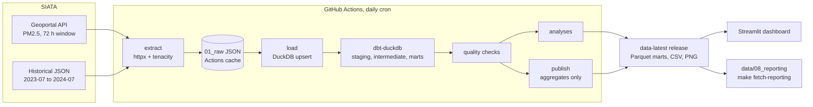
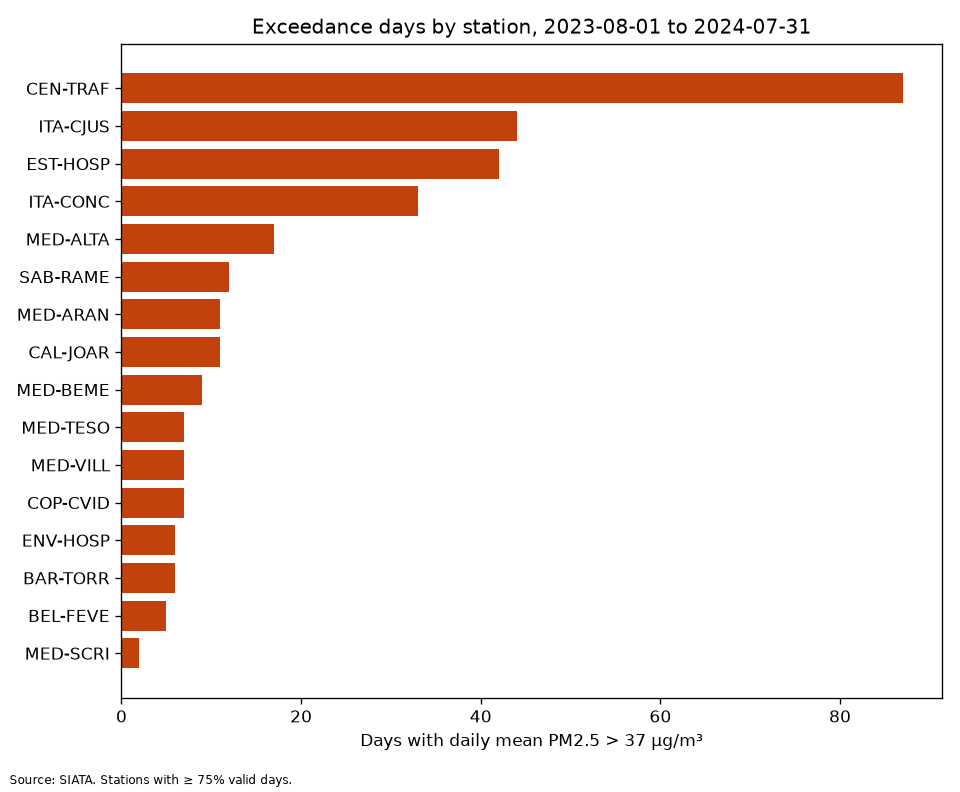
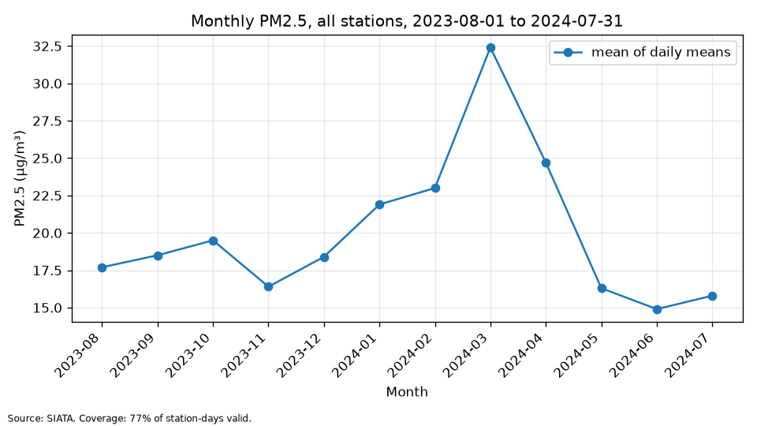
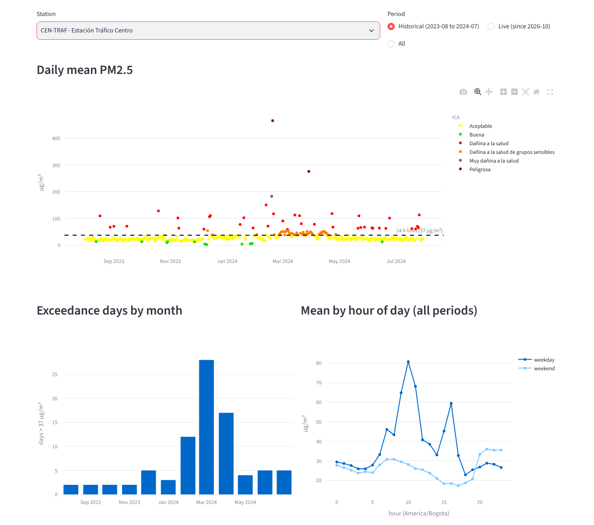

# Aburrá Valley Air Quality ELT

[](https://github.com/RafaGM1108/aburra-air-quality-elt/actions/workflows/ci.yml)
[](https://codecov.io/gh/RafaGM1108/aburra-air-quality-elt)
[](https://www.python.org/)
[](LICENSE)

> A daily, tested ELT pipeline that turns SIATA air quality measurements for Medellín and
> the Aburrá Valley into clean hourly and daily tables and a public dashboard.

## Overview

Python extractors pull hourly PM2.5 per station from SIATA every day, DuckDB stores it
with deduplication, and dbt models it into hourly/daily marts with exceedances and air
quality index (ICA) categories under Colombia's Resolución 2254 de 2017. Analyses rank
stations, describe seasonal, weekly and diurnal patterns, detect critical episodes and
benchmark next-day forecasts. A Streamlit dashboard reads the published aggregates.

## Motivation

The Aburrá Valley's topography traps pollutants, and PM2.5 episodes recur twice a year.
SIATA publishes live readings, but only a short rolling window: this project keeps the
history and makes it easy to answer which stations, hours and seasons are worst.

## Data

- **SIATA** geoportal API: hourly PM2.5 for ~23 official stations (72 h rolling window),
  collected daily. Historical JSON files cover 2023-07-31 → 2024-07-31 for a backfill.
- **Open-Meteo** (optional, not implemented yet): hourly weather covariates.

Only aggregates are published: daily and monthly PM2.5 by station, exceedances, ICA and
stations, as Parquet in the rolling
[`data-latest`](https://github.com/RafaGM1108/aburra-air-quality-elt/releases/tag/data-latest)
release refreshed by the daily run. Raw data and hourly series stay private.

Endpoints, limitations, terms and the Resolución 2254 thresholds are in
[`docs/data.md`](docs/data.md). Data is © SIATA / Área Metropolitana del Valle de Aburrá.

## Architecture



1. **Extract**: `httpx` + `tenacity` retries, one request per station per day with an
   identifying User-Agent; raw JSON lands in `data/01_raw`, kept between runs in the
   Actions cache.
2. **Load**: DuckDB raw tables, upserted and deduplicated on `(station_code,
   timestamp_hour)`; a later null never erases a value.
3. **Transform**: dbt-duckdb staging → intermediate → marts (hourly, daily with
   exceedances and ICA, monthly, hour of day), with schema, data and unit tests.
4. **Check**: freshness, row count, station coverage and duplicate checks fail the run.
5. **Analyze and publish**: station ranking, seasonal, weekly and diurnal profiles,
   critical episodes and forecast baselines; only daily and monthly aggregates are
   uploaded to the `data-latest` release.
6. **Serve**: a Streamlit + plotly dashboard reads the published marts.

Rules (valid day, exceedance, ICA, episodes) are in
[`docs/methodology.md`](docs/methodology.md).

## Results

Window 2023-08-01 to 2024-07-31, the only full year SIATA publishes. Every number comes
from a file in [`data/08_reporting/`](data/08_reporting/), downloaded from a Daily ELT
run with `make fetch-reporting` (`provenance.json` has each file's SHA-256). Details and
caveats are in [`docs/findings.md`](docs/findings.md).

| Finding | Value | Source |
|---------|-------|--------|
| Worst station | CEN-TRAF (Estación Tráfico Centro, Medellín): 87 days above 37 µg/m³ (24.3% of valid days), mean 34.9 µg/m³ | `station_ranking.csv` |
| Worst month | March 2024: 32.4 µg/m³, 106 station-days above the limit | `monthly_profile.csv` |
| Cleanest day of week | Sunday, 16.6 µg/m³ | `weekday_profile.csv` |
| Weekday peak hour | 10:00, 31.3 µg/m³ (minimum 18:00, 14.9 µg/m³) | `diurnal_profile.csv` |
| Critical episodes | 41 (32 prevención, 9 alerta) at 15 stations | `episodes.csv` |
| Best next-day baseline | 7-day mean, MAE 6.11 µg/m³ (persistence 6.12) on 5,612 station-days | `forecast_baselines.csv` |





### Dashboard



Run it with `make app`. It downloads the published marts from the `data-latest` release
on first start, so it needs no pipeline run.

## Project structure

```text
├── .github/workflows/      # ci.yml (lint, types, tests, dbt on fixtures), elt.yml (daily)
├── conf/base.yaml          # Paths and parameters
├── data/                   # Layered data (01_raw … 08_reporting), see data/README.md
├── dbt/                    # dbt-duckdb project: staging, intermediate, marts, seeds, tests
├── docs/                   # MkDocs Material site: data, methodology, findings, deploy
├── src/aburra_air/
│   ├── analysis/           # Ranking, patterns, episodes, forecast baselines, plots
│   ├── app/                # Streamlit dashboard
│   ├── data/               # Extract, load, quality, publish, dashboard queries
│   ├── pipelines/          # extract, load, transform, quality, analysis, publish
│   └── utils/              # Config loader and logging
├── tests/                  # Mirrors src/
└── Makefile                # Common commands (make help)
```

## Quickstart

Requires [uv](https://docs.astral.sh/uv/) and `make`.

```bash
git clone https://github.com/RafaGM1108/aburra-air-quality-elt.git
cd aburra-air-quality-elt
make install                 # dependencies + pre-commit hooks
cp .env.example .env         # then fill in secrets, if any
make lint typecheck test     # check everything works
```

| Command | What it does |
|---------|--------------|
| `make extract` / `make load` / `make transform` | Run one ELT step |
| `make quality` / `make analyze` / `make publish` | Check, analyze, stage the release |
| `make elt` | Run the full pipeline and the analyses |
| `make fetch-reporting` | Download the latest analysis outputs to `data/08_reporting` |
| `make app` | Streamlit on http://localhost:8501 |
| `make coverage` | Tests with an HTML coverage report |
| `make docs` | Serve the documentation locally |

## Roadmap

| Phase | Milestone | Status |
|-------|-----------|--------|
| 0 | Phase 0 - Setup | ✅ |
| 1 | Phase 1 - Extract | ✅ (optional Open-Meteo pending) |
| 2 | Phase 2 - Load and backfill | ✅ |
| 3 | Phase 3 - dbt models | ✅ |
| 4 | Phase 4 - Orchestration | ✅ |
| 5 | Phase 5 - Analysis | ✅ |
| 6 | Phase 6 - Dashboard | ✅ (public deploy pending) |
| 7 | Phase 7 - Docs and v1.0.0 | 🚧 |

Work is tracked on the [Kanban board](https://github.com/users/RafaGM1108/projects/12): one
milestone per phase, small issues, and a PR per issue.

## Tech stack

Python 3.12 · uv · httpx · tenacity · DuckDB · dbt-duckdb · Parquet · Streamlit · plotly ·
pytest · ruff · mypy · bandit · pre-commit · GitHub Actions · MkDocs Material

## Author

**Rafael E. Garcia**

- GitHub: [@RafaGM1108](https://github.com/RafaGM1108)
- LinkedIn: [linkedin.com/in/rafaelgarcia11](https://www.linkedin.com/in/rafaelgarcia11)

Licensed under the [MIT License](LICENSE).
